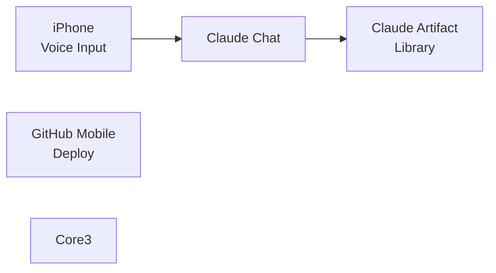
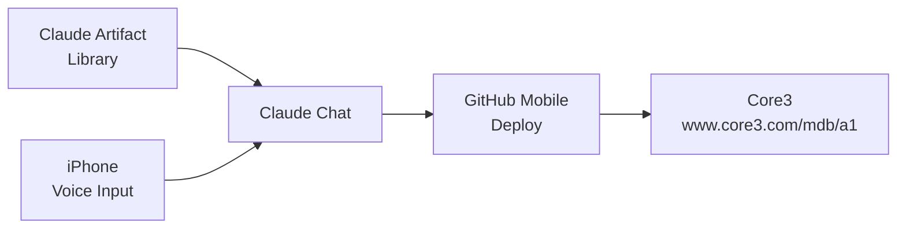

# mobile-deploy

Claude Mobile Only Web Apps.

## Purpose

This repo supports building and deploying web applications using only a mobile phone, with no laptop or desktop needed.

Apps are built by chatting (or speaking) with Claude on an iPhone and previewed there as Claude artifacts. Once an app looks right, it is committed to this repo and deployed to the Core3 web host with a GitHub Action, all from the phone. Each app is plain HTML, CSS, and JSON in its own folder under `mdb/`, and goes live at `www.core3.com/mdb/<app>`.

### Mobile Build

### Mobile Deploy

Each app lives in `mdb/<app>/` (plain HTML, CSS, JSON) and deploys to `www.core3.com/mdb/<app>`.
Example: `mdb/a1/` → `www.core3.com/mdb/a1`.

## Deploy

1. In GitHub: **Actions → Deploy app to Core3 (SFTP) → Run workflow**.
2. Enter the app folder name (e.g. `a1`).

The folder is uploaded over SFTP to `$SFTP_PATH/<app>`. Files are added or overwritten; nothing is deleted on the server.

## One-time setup: repository secrets

In GitHub: **Settings → Secrets and variables → Actions → New repository secret**.

| Secret | Value |
|---|---|
| `SFTP_HOST` | Core3 SFTP host name |
| `SFTP_USER` | SFTP user name |
| `SFTP_PASSWORD` | SFTP password |
| `SFTP_PATH` | Remote folder for the `mdb` apps, e.g. `/public_html/mdb` |

Never commit credentials to this repo.
