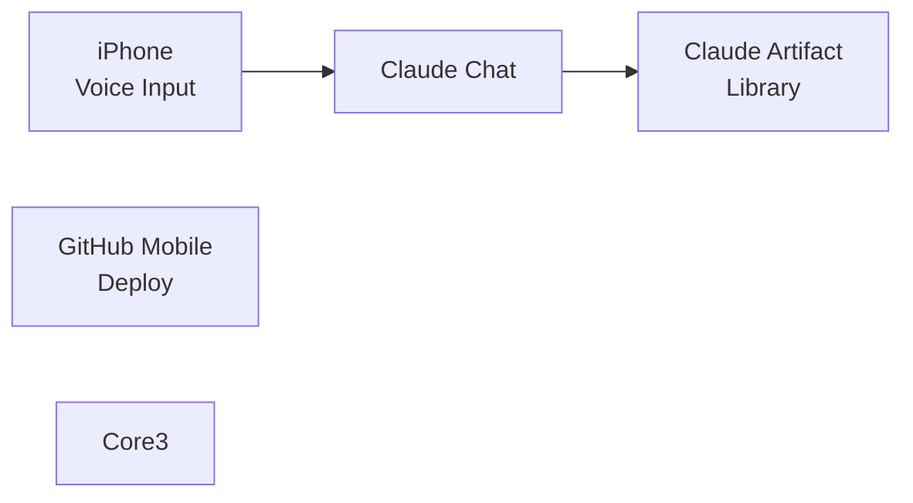
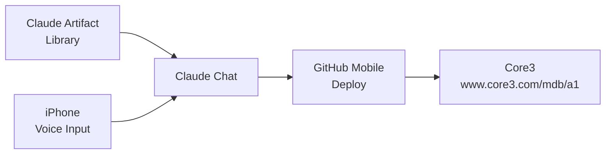

# mobile-deploy

Claude Mobile Only Web Apps.

## Purpose

This repo supports building and deploying web applications using only a mobile phone, with no laptop or desktop needed.

Apps are built by chatting (or speaking) with Claude on an iPhone and previewed there as Claude artifacts. Once an app looks right, it is committed to this repo and deployed to the Core3 web host with a GitHub Action, all from the phone. Each app is plain HTML, CSS, and JSON in its own folder under `mdb/`, and goes live at `www.core3.com/mdb/<app>`.

### Mobile Build

### Mobile Deploy

Each app lives in `mdb/<app>/` (plain HTML, CSS, JSON) and deploys to `www.core3.com/mdb/<app>`.
Example: `mdb/a1/` → `www.core3.com/mdb/a1`.

## The apps

| App | Live at | What it is |
|---|---|---|
| **a1** | `www.core3.com/mdb/a1` | First test app. A "message of the day" page with a tap button and a photo of the week. It proved the full loop: build in chat, commit, deploy, edit, redeploy, all from an iPhone. |
| **a2** | `www.core3.com/mdb/a2` | Second test app, built by Art. A small green card page with a tap counter, used to check the same workflow end to end. |
| **a4** | `www.core3.com/mdb/a4` | **RxKeep**, a real app for managing prescriptions (described below). |

a1 and a2 read their text from a `data.json` file, so the words can be changed without touching the page code.

## RxKeep (a4)

### The problem it solves

Prescriptions pile up. There are several bottles, some from different doctors and pharmacies, some of the same drug, and it is hard to remember what you have, what is running low, what you already took today, and why you were given each one. RxKeep keeps all of that on your phone in one place, and you never have to type a medication in: you photograph the bottle.

### What it does

- **Inventory of every bottle you own.** Duplicates are fine. Two bottles of the same drug from different pharmacies are kept as separate bottles, and a combined total is shown per medication.
- **Photo import.** Take two or three pictures of a bottle (name, strength, pharmacy, doctor) and import them from the camera roll. The app reads the labels and fills in the details, and flags anything it is unsure of as "check this".
- **Daily plan.** A Today page lists the doses due, each with a tap to mark it taken (tap again to undo). Taking a dose reduces the count of pills left.
- **Spare bottles.** A bottle can be switched between "Taking daily from this bottle" and "Spare", so extra bottles don't double up on the daily plan.
- **Short courses.** For a finite treatment (for example a five-day antiviral), mark it as a short course. It shows days of course left and disappears from Today when finished.
- **Supply warnings.** Shows how many days of pills are left and warns when a bottle is low or out, with a refill button that updates quantity and refills.
- **Backup files.** Save your data to a file and load it again, with a confirmation before anything is replaced. This is how you move data between devices, since each browser keeps its own copy.
- **Demo link.** Adding `?demo=1` to the address opens a copy filled with made-up sample data, kept separate from real data, so it can be shown to a friend safely.
- **Link previews and Home Screen icon.** Pasting the link into a text message shows a title and picture, and it can be added to the iPhone Home Screen like an app.
- **Drug descriptions (planned).** A page with a short plain-language summary of what each medication is generally used for, with each drug name in the app linking to it, plus a personal "why I take it" note.

### How your data is stored

Data stays on your device, in the browser. Nothing is sent to Core3. Safari, Chrome, the Home Screen copy and the Claude preview each keep their own separate copy, so use the backup file to move data between them. These apps give general information only and are not medical advice.

## Deploy

1. In GitHub: **Actions → Deploy app to Core3 (SFTP) → Run workflow**.
2. Enter the app folder name (e.g. `a1`).

The folder is uploaded over SFTP to `$SFTP_PATH/<app>`. Files are added or overwritten; nothing is deleted on the server.

## One-time setup: repository secrets

In GitHub: **Settings → Secrets and variables → Actions → New repository secret**.

| Secret | Value |
|---|---|
| `SFTP_HOST` | Core3 SFTP host name |
| `SFTP_USER` | SFTP user name |
| `SFTP_PASSWORD` | SFTP password |
| `SFTP_PATH` | Remote folder for the `mdb` apps, e.g. `/public_html/mdb` |

Never commit credentials to this repo.
